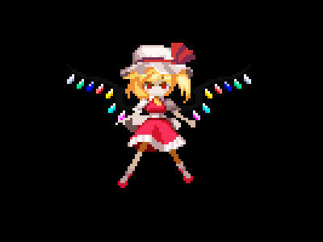
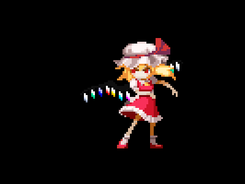
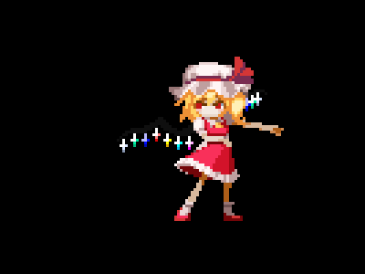
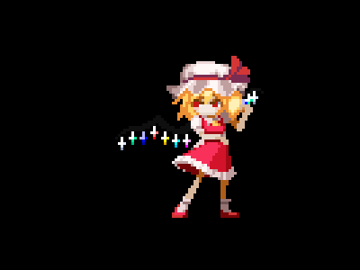
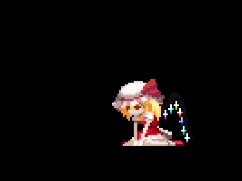

# Pets

A pixel-art desktop companion for macOS, built with C++17, Raylib, and Cocoa. Flandre sits above your windows, reacts to the cursor, and cycles through animated poses while you work.

## Artwork credits

Flandre Scarlet sprites are from **Touhou Luna Nights**, sourced from [The Spriters Resource](https://www.spriters-resource.com/pc_computer/touhoulunanights/asset/138319/).

- **Uploaded by:** Mysticus
- **Contributor:** Adrot
- **Submitted:** August 27, 2020

The source page credits Mysticus as the uploader and Adrot as a contributor; it does not identify the original sprite artist. The sprite artwork was not created for this project.

## Screenshots

<table>
  <tr>
    <th width="33%">Idle</th>
    <th width="33%">Reach</th>
    <th width="33%">Wave</th>
  </tr>
  <tr>
    <td align="center"></td>
    <td align="center"></td>
    <td align="center"></td>
  </tr>
  <tr>
    <td>Layered body and wing animation.</td>
    <td>A reaching pose in the automatic animation cycle.</td>
    <td>A waving pose in the automatic animation cycle.</td>
  </tr>
</table>

<table>
  <tr>
    <th width="50%">Hand to face</th>
    <th width="50%">Down</th>
  </tr>
  <tr>
    <td align="center"></td>
    <td align="center"></td>
  </tr>
  <tr>
    <td>A hand-to-face gesture between animation cycles.</td>
    <td>The starting pose, held longer than the other animations.</td>
  </tr>
</table>

Screenshots show the app's rendered poses with a transparent background.

## Features

- **Transparent desktop companion.** A borderless, always-on-top window keeps the pet visible above other apps.
- **Drag to reposition.** Hold the left mouse button inside the pet window and move it around your desktop.
- **Automatic animations.** Cycles through down, idle, reach, wave, and hand-to-face poses. Down lasts 20 seconds; the other poses last 10 seconds each while cursor reactions are inactive.
- **Cursor reactions.** Looks left or right when the cursor enters the corresponding side of the main display's upper half, outside a 300-pixel zone on either side of the horizontal center. These reactions temporarily pause the automatic cycle.
- **Pixel-art rendering.** Point-filtered sprites render at 3x scale, with separate animated wings in the idle pose.
- **macOS Spaces support.** The window is configured to join all Spaces and act as an auxiliary window alongside full-screen apps.
- **Manifest-based assets.** Sprite groups and frame order are defined in `asset/flandre.json`.

## Requirements

- macOS; the current platform integration uses Cocoa and Objective-C++.
- Xcode Command Line Tools with a C++17 compiler and `make`.
- Raylib.
- Python 3 for generating editor compile commands.
- Homebrew or `pkg-config` for automatic Raylib flag detection.

The nlohmann/json 3.11.3 header is included in `third_party/`; no separate JSON library installation is needed.

## Build and run

Install the developer tools if needed:

```sh
xcode-select --install
```

With Homebrew installed, install the remaining dependencies:

```sh
brew install raylib pkg-config python
```

From the project root:

```sh
make
make run
```

The executable is `./pets`. Run it from the project root so the relative `asset/` paths resolve correctly. Press Escape while the pet window is focused to close it, or press Ctrl+C in the terminal that launched it.

To remove the executable and generated build files:

```sh
make clean
```

Raylib compiler and linker flags are detected through `pkg-config`, with a Homebrew fallback. For a custom installation:

```sh
make RAYLIB_CFLAGS="-I/path/to/raylib/include" RAYLIB_LIBS="-L/path/to/raylib/lib -lraylib"
```

## Project structure

```text
asset/                 Sprite frames and flandre.json manifest
docs/screenshots/      README screenshots
src/
  main.cpp             Pet rendering, animation cycle, and cursor reactions
  assets/              JSON manifest loading through AssetManager
  platform/            macOS window and global mouse integration
  window/              Window dragging
scripts/               Compile-command generation
third_party/           Bundled nlohmann/json header and license
Makefile               Build, run, and clean targets
```

`make` discovers `.cpp` and `.mm` files recursively under `src/`, tracks header dependencies, and generates `build/compile_commands.json` for clangd and VS Code. Run `make` again after moving the project or changing compiler settings. The executable and `build/` directory are excluded from Git.

## Asset manifest

`asset/flandre.json` lists sprite paths in frame order for these groups:

| Group | Frames | Use |
| --- | ---: | --- |
| `idle` | 5 | Standing body animation |
| `wings` | 5 | Wing layer paired with idle frames |
| `lookLeft` | 4 | Left cursor reaction |
| `lookRight` | 4 | Right cursor reaction |
| `reach` | 9 | Reaching gesture |
| `wave` | 9 | Waving gesture |
| `handToFace` | 6 | Hand-to-face gesture |
| `down` | 4 | Starting pose |

Paths are relative to the project root. `AssetManager::LoadAsset("asset/flandre.json", "idle")` returns point-filtered textures. Load textures after `InitWindow` and unload them before `CloseWindow`.

Animation lengths are also encoded in `src/main.cpp`; keep those frame counts in sync when changing the manifest.

## Third-party notices

The bundled nlohmann/json library includes its [MIT license](third_party/nlohmann/LICENSE.MIT). Sprite source credits are listed above the screenshots. This repository does not currently include a project-wide license or a separate license notice for the sprite artwork.
